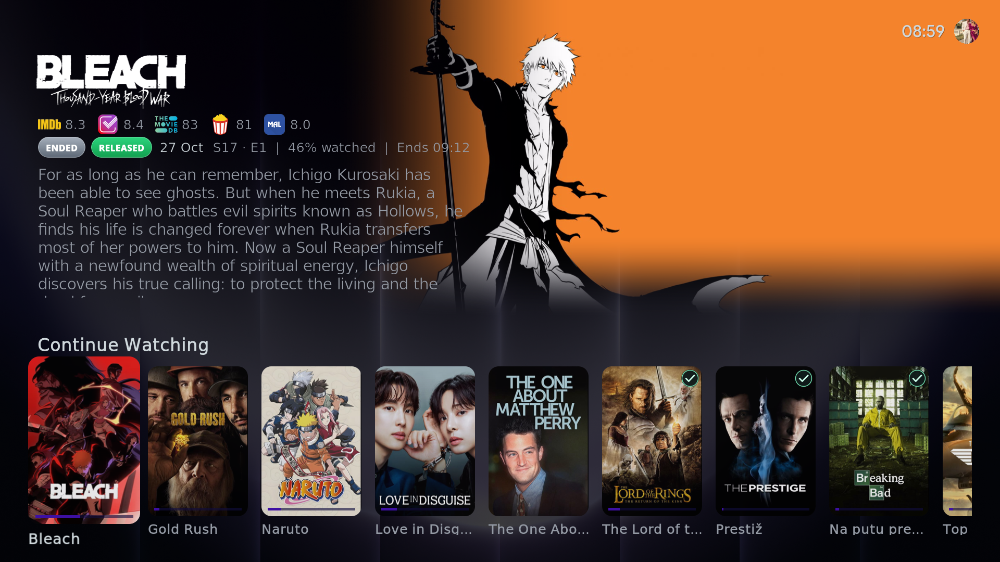
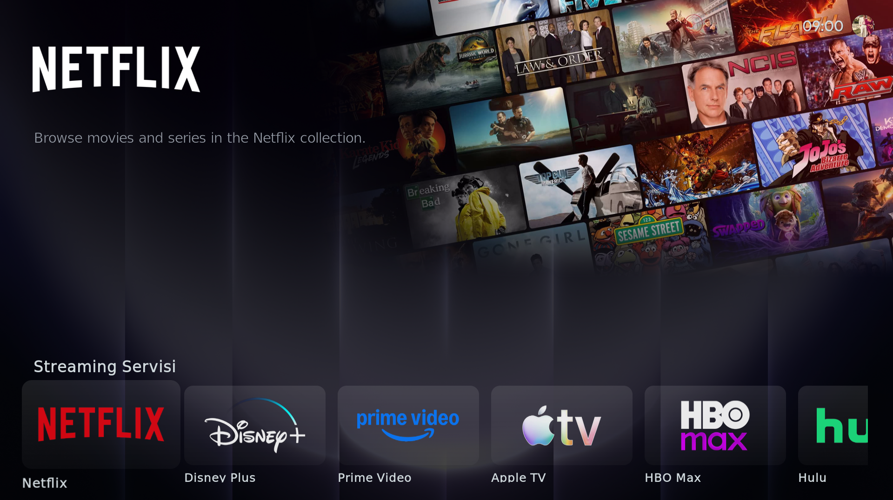
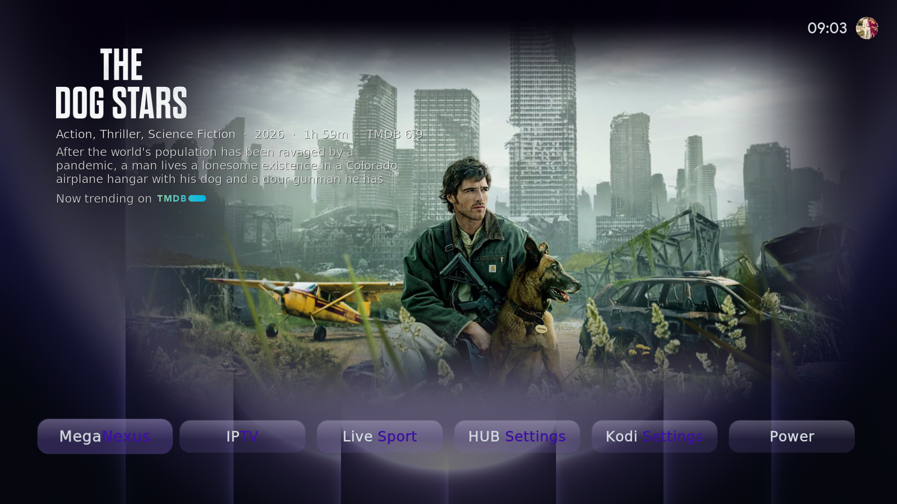
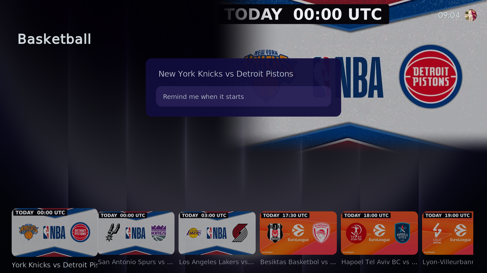
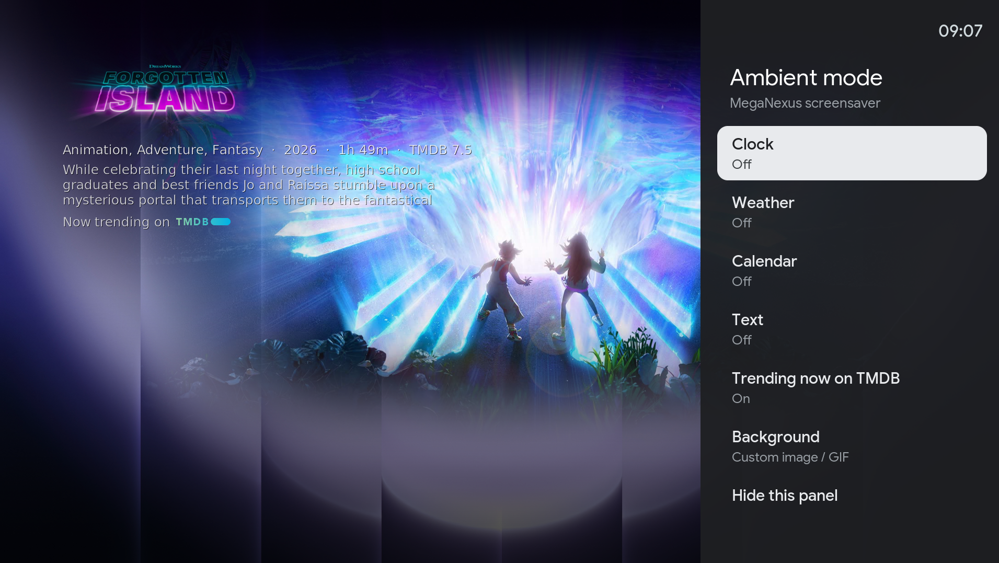
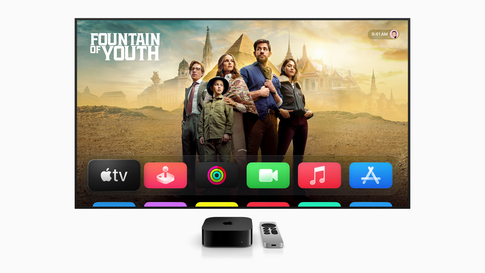
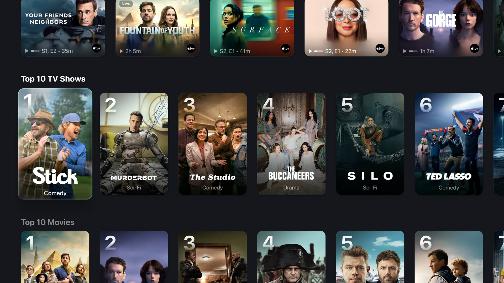

  

  
  
  
  

<h3 align="center">Kodi, turned into a streaming app.</h3>

<b>Your Stremio and Nuvio add-ons, your debrid, your accounts — 
in one fast interface built for the remote, with Kodi's player underneath.</b>

---

## What is MegaNexus?

MegaNexus replaces everything you see in Kodi — Home, menus, title pages, the player and the
screensaver — with one app made for the TV remote. Like **Stremio** and **Nuvio**, it is driven by
**add-ons you add with a link**: metadata add-ons bring the movies and series, stream add-ons bring
the links to play, subtitle add-ons bring the subtitles.

- ✅ **Every Stremio and Nuvio add-on works** — Torrentio, AIOStreams, AIOMetadata, Comet,
  MediaFusion, Cinemeta, OpenSubtitles and the rest. Paste the link you already use, or sign in and
  bring all of them over at once.
- 🎞️ **Kodi still does the playing** — every codec, Dolby Vision and HDR, refresh-rate switching,
  CoreELEC and Android TV boxes.
- 🚫 **No classic Kodi video add-ons needed** — MegaNexus doesn't use them, and they only slow Kodi down.

MegaNexus is free for personal use. It does not host or provide any media: it plays what your own
accounts, servers and add-ons give you.

  
  

  
  
  

▶️ <b><a href="https://github.com/MegaNexusMediaPlayer/MegaNexus/releases/download/v9.0.0/MegaNexus-9.0.0-preview.mp4">Watch MegaNexus 9.0.0 in action (video)</a></b> · 🖼️ <a href="docs/SCREENSHOTS.md">All screenshots</a>

## ✨ Everything it does

### 🏠 Watching
- **Home** with Continue Watching, your collections and catalog rows, a big picture of the title under the cursor and its trailer — the sound fades in, never a blast.
- **Title pages** with the full story, ratings (IMDb, Rotten Tomatoes, Metacritic, Letterboxd… via MDBList), reviews, seasons and episodes with their own ratings, cast, and *More like this*.
- **Search** across all your metadata add-ons, a **Library** of what you saved, with a **Calendar** of when you added it.
- **Trending now on TMDB**, release badges (*4K · HDR · Digital*), and unreleased titles hidden if you like.
- **Who's watching?** — profiles with their own picture, PIN, tracking accounts and Continue Watching.
- **Trailers in a blink** — the trailer link is found while the title page opens, so *Trailer* starts at once, and Back goes straight back to the page.

### ⚡ Streams
- **Debrid built in** — TorBox, Premiumize, Offcloud, Real-Debrid, AllDebrid and Easynews: add your key and their results join your add-ons'.
- **Fast source list** — opens with the first results and fills in as each add-on answers; every source shows where it comes from, with stream badges (six ready-made sets, or your own Nuvio badge JSON).
- **The best stream, chosen for you** — REMUX → Blu-ray → WEB-DL, release groups rated by TRaSH Guides, Dolby Vision / HDR and the best audio (TrueHD Atmos, DTS-HD MA…). *No limit* picks the best link your network can actually carry.
- **Never stuck on a dead link** — a source that doesn't start is skipped quietly and the next one tried; you see one message only if nothing plays.
- **Usenet with a native C++ player** — your own provider, Newznab indexers, Prowlarr and Spotnet; films start and seek straight from Usenet.
- **Downloads** — keep a film or episode on your device or network share; a lost connection carries on where it stopped.

### 💬 Subtitles
- **One button, every subtitle add-on** — the list opens at once and fills while the add-ons answer: add-ons on top, languages by their full name on the right with yours first, and where every subtitle comes from. The film waits while you choose; the file's own fingerprint (hash) marks the subtitles made for exactly your file.
- **Autosync** — lines a subtitle up with the video's own subtitles, or with the timing most other subtitles agree on. No AI, no audio analysis, and it never makes a good subtitle worse.
- **Checked by itself** — a subtitle from online is checked once in the background and lined up only when it is clearly off.
- **AI subtitles in your language** — no subtitle in your language? Google Gemini translates one (one or two free keys), starting where you are watching and showing lines as they arrive. Names stay consistent with a glossary per series, and the translation is kept for next time.
- **Anime done right** — long anime are found by their absolute episode number too (Naruto S5E7 = episode 186).

### ▶️ The player
- **Skip intro / recap / outro** — only with trusted times (TheIntroDB, SkipDB), as a pill that empties while the part runs. OK skips, Back hides it.
- **Next episode** at the right moment, as the next episode's picture (with TVmaze as a backup when the metadata doesn't know it).
- **Resume quietly** — no sound burst while a resumed film finds its place; a stream that breaks off midway is kept where it stopped, not marked as watched.
- **Dolby Vision diagnostics** — what the source is and how Kodi processes it, kept apart.

### 🔄 Your progress, everywhere
- Sync with **Nuvio**, **Stremio**, **Trakt**, **Simkl**, **MDBList** and **WeTrakr** — progress, watched marks, watchlists and your library, both ways.
- One Continue Watching card per title, whatever app saved it.
- **Accounts that stay signed in** — when Nuvio or Stremio end a session, MegaNexus signs in again by itself; Trakt's one-time renewals are handled one at a time. An account that really is signed out says so once, as a small Kodi notification.

### 🍿 Watch Party
Watch together with friends on other TVs: everyone starts the film together, pause and jumps follow
the host, messages appear in the player, and your phone is the party remote.

### 📺 Live TV and Sport
IPTV (Xtream or M3U, several lists) with guide, preview, catch-up and channel groups; the films and
series of your list appear as sources; a Sport screen for live events.

### 📱 Your phone does the typing
- **Set up on phone** — scan a QR code and set up accounts, add-ons, API keys, collections and the look from your phone.
- **Write with phone** — every on-screen keyboard takes text from your phone.
- **User guide** and **Report a problem** — the guide on the TV, and a report that sends the Kodi log with personal data removed.

### 🎨 Make it yours
- **Light, Dark and Dim** themes; your own wallpaper with colours that follow it.
- **MegaNexus Ambient** — a Google TV-style screensaver with clock, weather and calendar widgets, over your picture, a slideshow or a video sent from your phone.

### 🖥️ Your own media
Plex, Jellyfin / Emby and local or network drives — your own copy of a title is offered first when you play it.

### 🚀 Built for TV boxes
- **Native posters (VFS)** — posters and artwork come through MegaNexus' own C++ add-on (vfs.meganexus): fetched ahead on 12 connections and kept in memory, with no local port and no Python in the way. Home opens with its pictures already there.
- Memory limits for 2 GB boxes, memory given back after you leave, and Home redraws only what changed.

- **One picture per title** — change where posters, backgrounds or logos come from (Artwork) and the switch is done at once behind the loading screen, with the old pictures removed; every week the screensaver clears the pictures not shown for a week.

> [!TIP]
> **Switch to native posters.** After the update MegaNexus asks once — answer **Switch now**. Or any time:
> HUB Settings → **Performance & image cache → Picture path → vfs.meganexus (mnxart)**.
> It is the faster and steadier way: no port that can change, so Kodi never stores the same library twice, and
> no picture passes through Python. MegaNexus installs vfs.meganexus by itself; until it is there, the image
> proxy carries on as before. The switch clears the pictures Kodi kept for the old path and loads them once more.

### 🔐 Backup and privacy
- **Backup in one file** — everything, or everything *except* sign-ins, passwords, user names and API keys (safe to hand on). Restore sets up a new device in a minute.
- Passwords and keys stay on your device and never appear in logs or problem reports.

## 🚀 Install

**You need:** Kodi 21 (Omega) or Kodi 22 (Piers) on Android TV / Fire TV, CoreELEC / LibreELEC,
Windows, Linux or macOS. A debrid account is recommended for fast streams.

**From the MegaNexus repository** — recommended, updates arrive by themselves:

1. Kodi **Settings → File manager → Add source**: `https://meganexusmediaplayer.github.io/MegaNexus/`, name it `MegaNexus`.
2. **Add-ons → Install from zip file → MegaNexus** → the repository zip.
3. **Add-ons → Install from repository → MegaNexus Repository → Video add-ons → MegaNexus Hub**.
4. The interface, skin and screensaver install themselves. When Kodi asks to keep the MegaNexus skin, answer **Yes**.

**Or from the zip:** download **`MegaNexus-Complete-9.0.0.zip`** from
[Releases](https://github.com/MegaNexusMediaPlayer/MegaNexus/releases/latest) (not GitHub's
"Source code" archive) → **Add-ons → Install from zip file**.

More in [docs/INSTALL.md](docs/INSTALL.md).

## ⚙️ First steps

1. **HUB Settings → Set up on phone** → scan the QR code (same Wi-Fi).
2. Sign in to **Nuvio** or **Stremio** to bring your add-ons over — or paste add-on links yourself.
3. Add your **debrid** key and any API keys you like (each links to where you get it).
4. **Save & start MegaNexus.** Then save a backup — restoring it sets up any new device in a minute.

Nothing is required: with no setup, MegaNexus starts with Cinemeta and a ready-made Home.

## ❓ FAQ

<b>Is MegaNexus an add-on or a skin?</b>

Both, as one build: four add-ons that install together — the engine (MegaNexus Hub), the
interface (MegaNexus), MegaNexus Skin and MegaNexus Screensaver. You install one, the others follow.

<b>Where do I get add-ons?</b>

Use the same add-ons as the Stremio or Nuvio apps. Open an add-on's **Configure** page in a
browser (for example `torrentio.strem.fun/configure`), choose its options and your debrid service,
and copy the install link (it ends in `manifest.json`). Paste it in **HUB Settings → Add-ons**, or on
the phone page. Already using Nuvio or Stremio? Sign in and all of them come over at once.

<b>Do I need a debrid service?</b>

No, but it makes streams start instantly. TorBox, Premiumize, Offcloud, Real-Debrid, AllDebrid and
Easynews are built in (**HUB Settings → Debrid & Usenet**); others work through your stream
add-on's configure page.

<b>A stream doesn't start.</b>

MegaNexus moves on to the next source by itself and tells you only when none plays. If it happens
often, turn on *cached results first* so the list starts with links that play at once.

<b>Do AI subtitles cost anything?</b>

Google gives a free Gemini key with a daily allowance — usually plenty for several episodes a day.
A second key doubles the speed and the allowance.

<b>Can I type with my phone?</b>

Yes. Every on-screen keyboard has **Write with phone**: scan the code, type, and the text goes
straight in.

<b>MegaNexus is slow on my box.</b>

On 2 GB boxes set **HUB Settings → Performance & image cache → Memory for posters and catalogs**
to 128 MB, and keep only the add-ons you use.

<b>Colours look wrong when an HDR film starts (Linux desktop).</b>

Turn off **Kodi Settings → System → Display → Adjust display HDR mode**; Kodi then converts HDR
films itself.

<b>Where is the full guide?</b>

**HUB Settings → Help & diagnostics → User guide** explains every screen and setting on the TV.

## 🧩 The add-ons

| Add-on | What it is |
|---|---|
| **MegaNexus Hub** (`plugin.video.meganexus`) | The engine: accounts, add-ons, playback, sync, downloads and updates. |
| **MegaNexus** (`script.meganexus`) | The interface: Home, collections, title pages, player, settings, phone setup. |
| **MegaNexus Skin** (`skin.meganexus`) | The Kodi skin around it, with the MegaNexus HUB. |
| **MegaNexus Screensaver** (`screensaver.meganexus`) | MegaNexus Ambient: clock, weather and calendar over your picture, a slideshow or a video. |
| **MegaNexus VFS** (`vfs.meganexus`) | Native posters and the native Usenet player (C++) — installs itself. Source in [vfs.meganexus](vfs.meganexus) (GPL-3.0). |

## 🤝 Community and help

- 💬 Questions, setups and ideas: **[r/MegaNexus](https://www.reddit.com/r/MegaNexus/)**
- 🐞 Found a bug? **HUB Settings → Help & diagnostics → Report a problem** sends it with the Kodi log (personal data removed), or open a **[GitHub issue](https://github.com/MegaNexusMediaPlayer/MegaNexus/issues)**.
- 🛠️ Want to help? See **[CONTRIBUTING.md](CONTRIBUTING.md)**.
- ☕ Like it? **[Buy me a coffee on Ko-fi](https://ko-fi.com/master100janovic)** — optional; MegaNexus is free for personal use.

## 🍎 Next goal: an Apple TV-inspired MegaNexus

  
   
  The look we are aiming for — Apple TV with tvOS 26. Images: Apple, shown for inspiration only.

Hi everyone! 👋

I'm starting a new development goal to bring a complete **Apple TV-inspired experience** to Kodi through MegaNexus.

The vision is a clean, premium interface with an Apple TV-style home screen, beautiful content artwork, immersive
collections, modern navigation, and a smooth, polished user experience.

🎯 **Funding goal: $100**

Your support will help fund development, testing, and refinement of this new visual experience.
If you'd like to help make this happen and see MegaNexus evolve even further, consider supporting the project on
**[Ko-fi](https://ko-fi.com/master100janovic)**.

Every contribution makes a difference. Thank you for supporting independent development and being part of the
MegaNexus community! ❤️

## 📄 License

MegaNexus is an original project under the **[MegaNexus License](LICENSE.md)**: free for personal
use; redistribution, modified versions and commercial use need the author's written permission.
The skin is built on Kodi's Estuary skin and keeps its GPL-2.0 license; the Usenet player is
GPL-3.0. See [third-party notices](THIRD_PARTY_NOTICES.md).

MegaNexus does not host or provide any media. It plays what your own accounts, servers and add-ons
give you, so only use sources you are allowed to access.

What's new: <a href="CHANGELOG.md">CHANGELOG.md</a>
