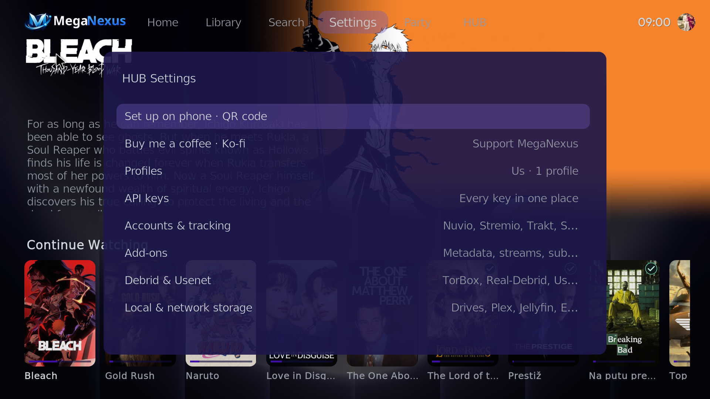
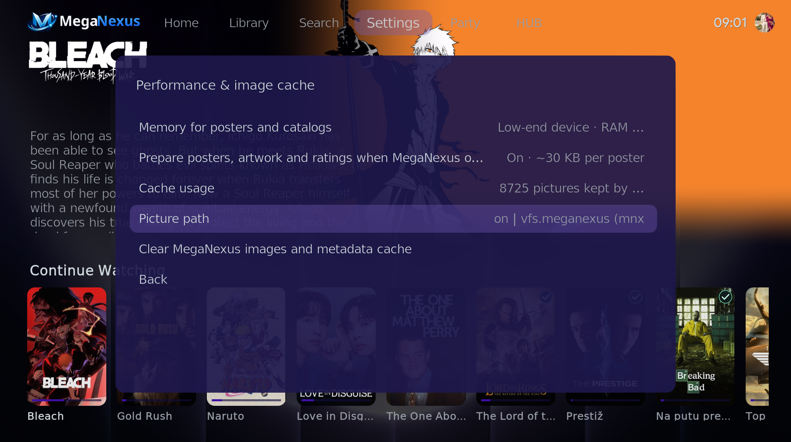
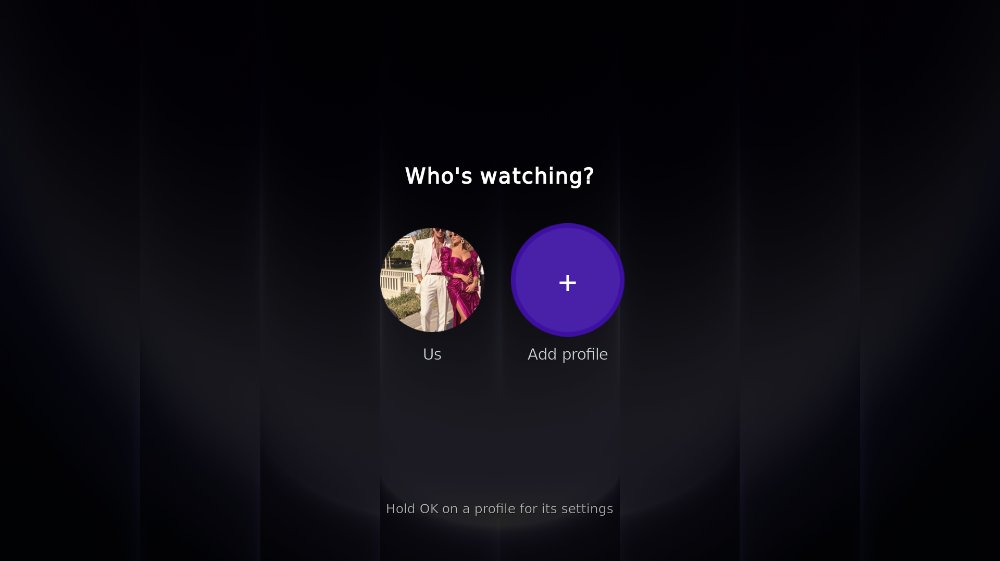
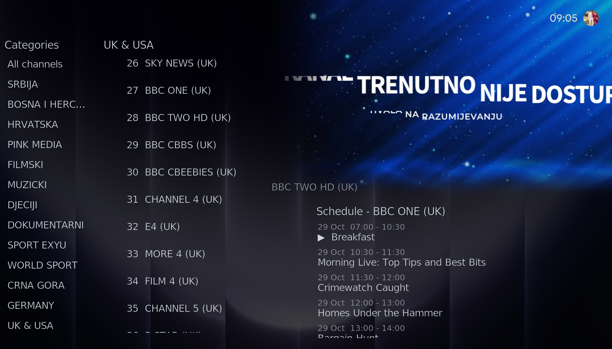

# Screenshots

MegaNexus 9.0.0 on a PC (Kodi 22). It looks the same on Android TV, Fire TV and CoreELEC.

▶️ **[Watch MegaNexus 9.0.0 in action (video)](https://github.com/MegaNexusMediaPlayer/MegaNexus/releases/download/v9.0.0/MegaNexus-9.0.0-preview.mp4)**

## Home

Continue Watching, ratings from every service, and the title under the cursor in big.

## Collections

Your collections as rows of cards — here the streaming services.

## The MegaNexus HUB

Kodi's own home, turned into a HUB: what is trending on TMDB, and every part of MegaNexus one click away.

## HUB Settings

Everything in one place: set up on phone, profiles, API keys, accounts, add-ons, debrid and storage.

## Native posters

Performance & image cache → Picture path → vfs.meganexus: the recommended, faster way to load pictures.

## Who's watching?

Profiles with their own picture, PIN, accounts and Continue Watching.

## Live Sport

Today's events with reminders when they start.

## Live TV

IPTV lists with categories, preview and the guide.

## MegaNexus Ambient

The screensaver with what is trending, clock, weather and calendar — and its settings panel.

