# Screenshots

MegaNexus 9.2.0 on a PC (Kodi 22), the new look. It looks the same on Android TV, Fire TV and CoreELEC.

## The HUB

Kodi's own home, turned into a HUB: every app a tile, what is trending on TMDB behind them.

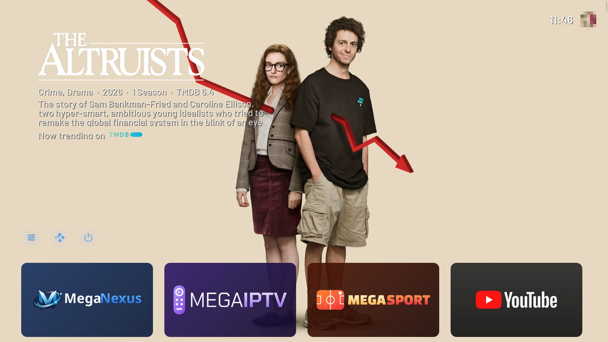

Down from the first tiles: Music, Plex, Jellyfin and Emby ...

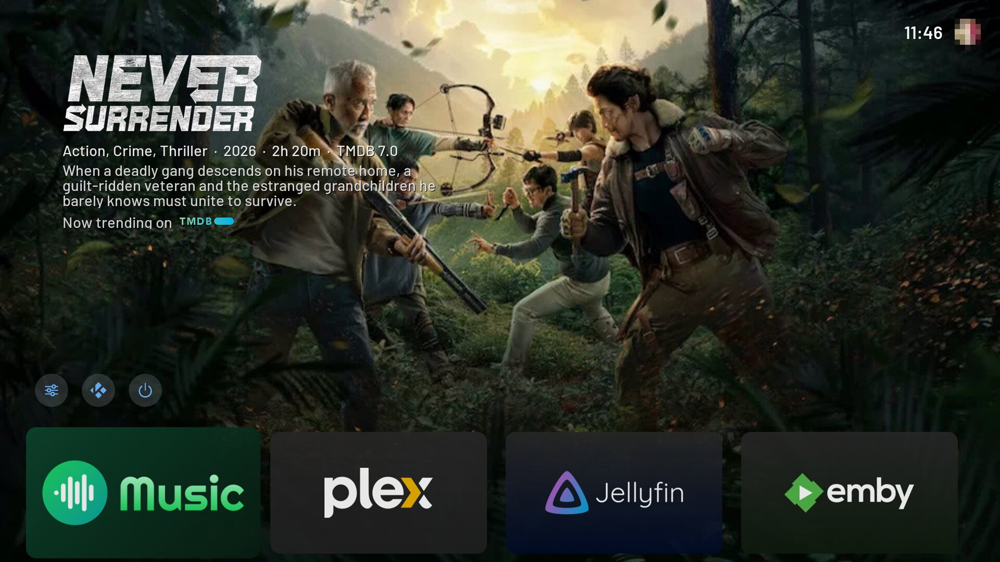

... and the games for the whole room, played with your phones.

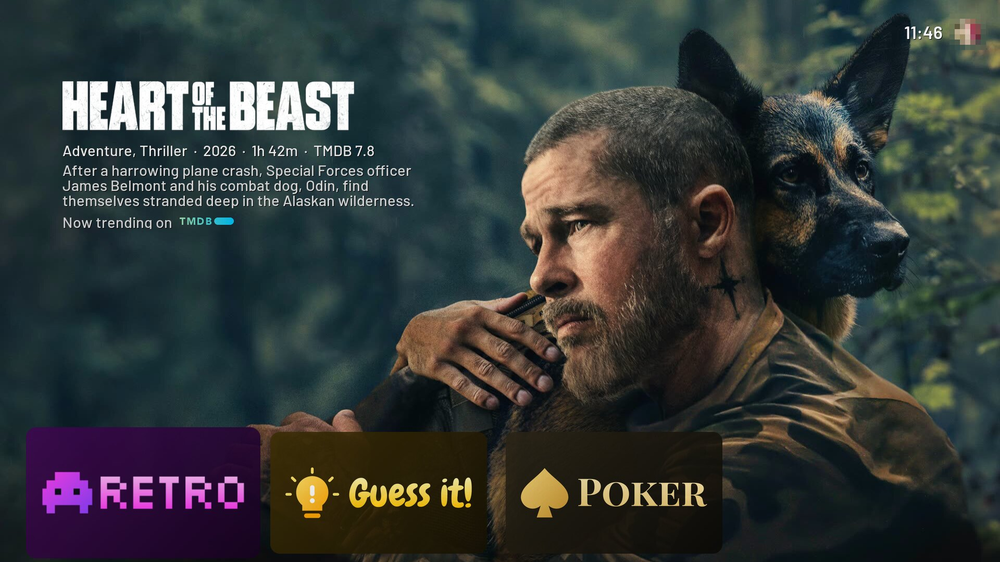

## Home

Big cards, the title under the cursor across the top with its trailer behind, Continue Watching first.

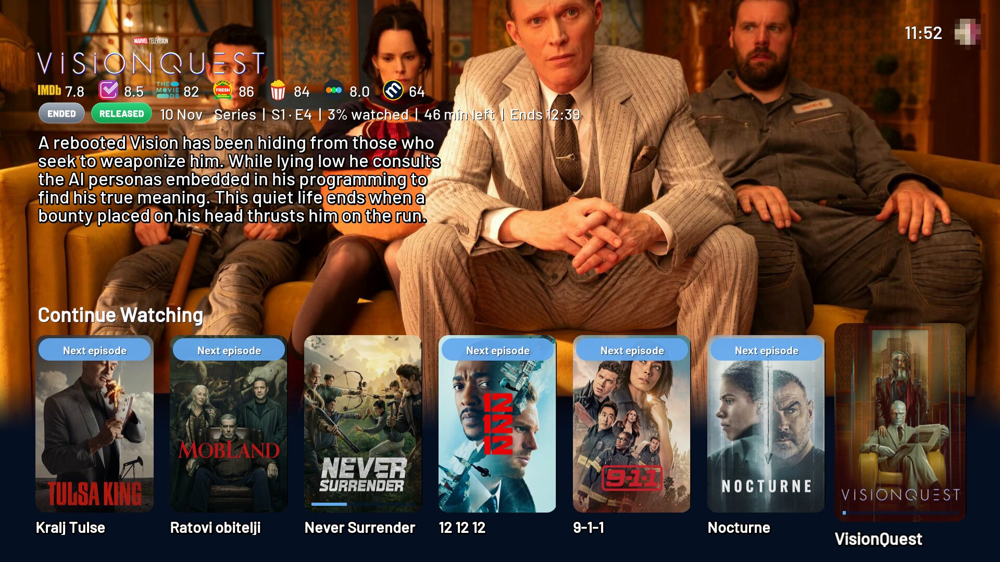

Top 10 rows from TMDB, Trakt, Simkl or MDBList, with big numbers.

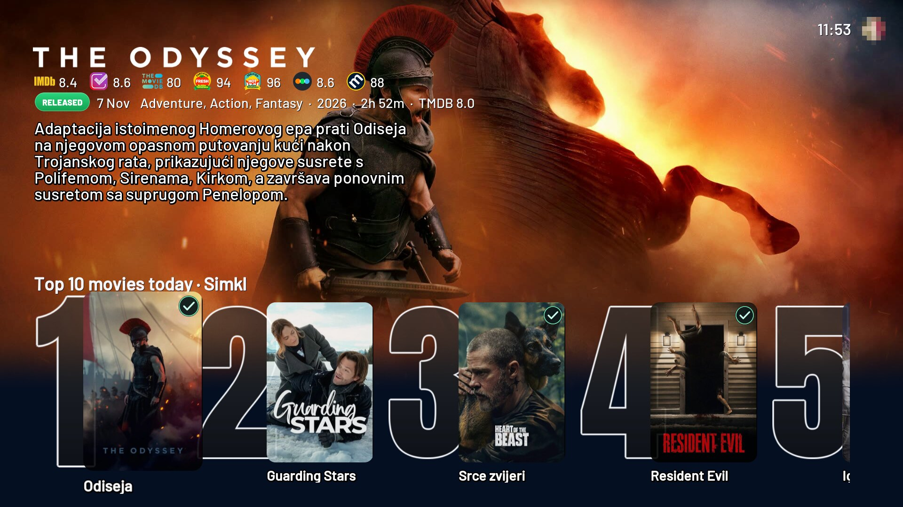

## Library

Everything you track in one place - each service with how many titles it holds.

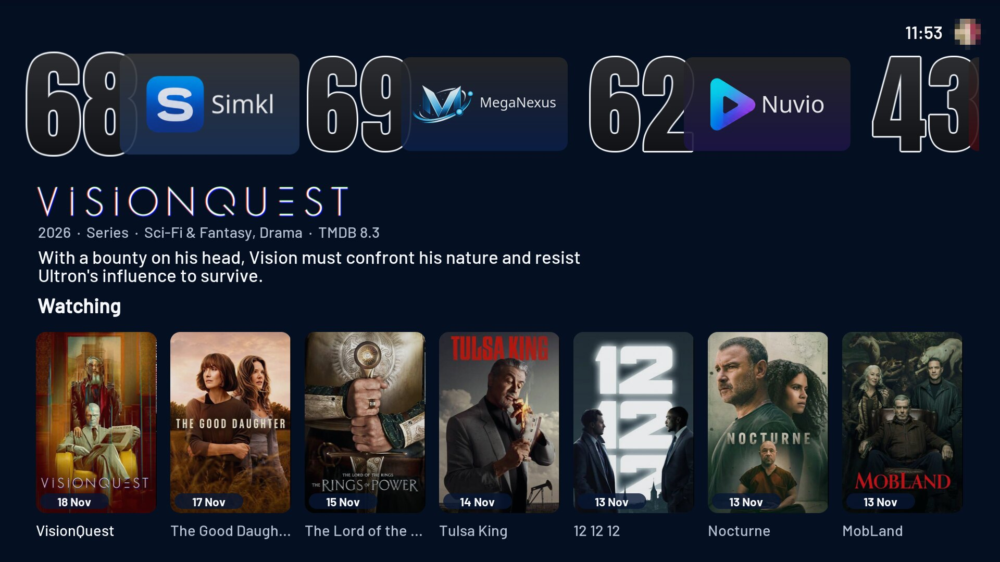

## Calendar

What comes out, day by day, the title under the cursor at the top.

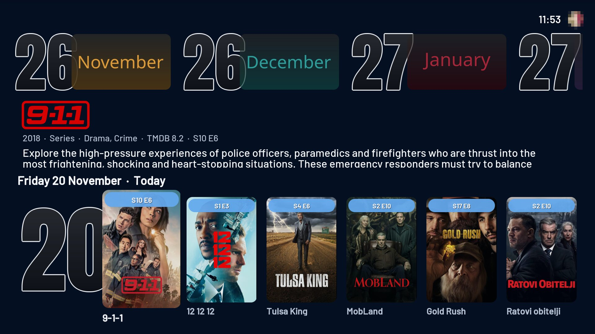

## MegaIPTV

Your IPTV lists as rows: Live TV, the channel under the cursor with what is on now and next.

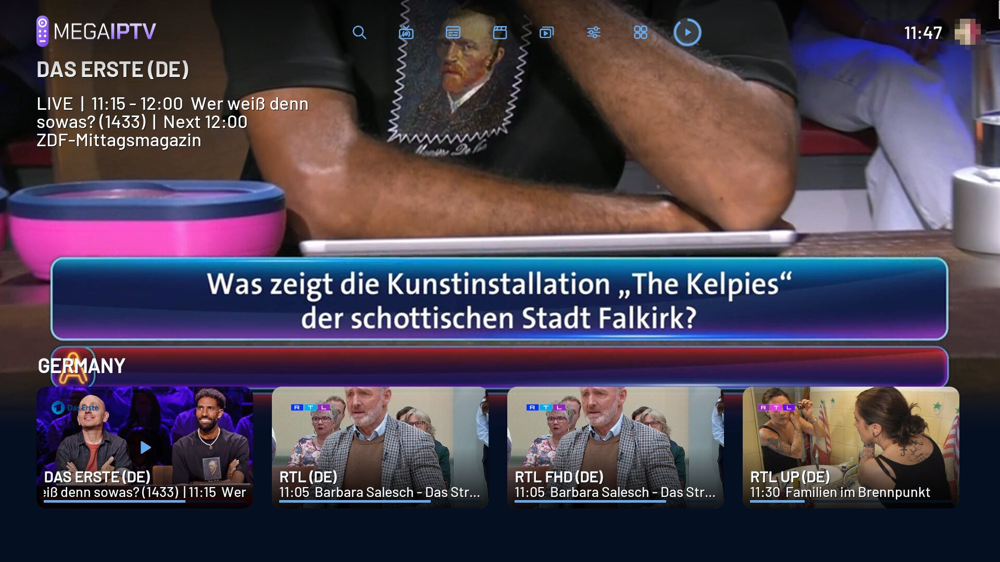

The guide, group by group.

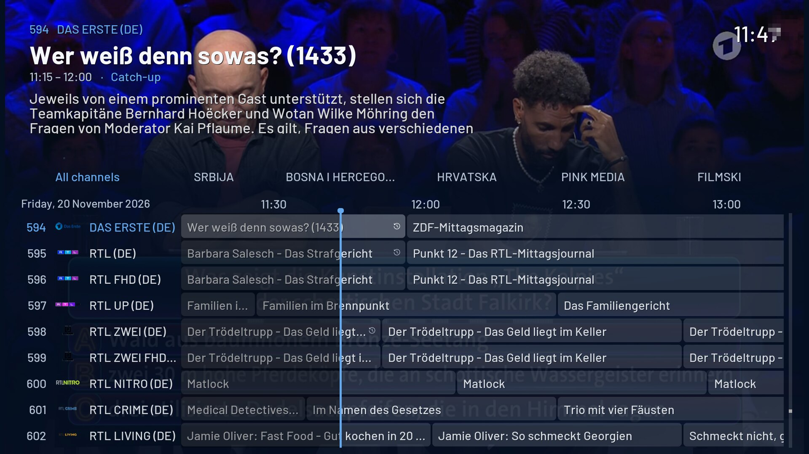

Your list's films and series as rows of posters.

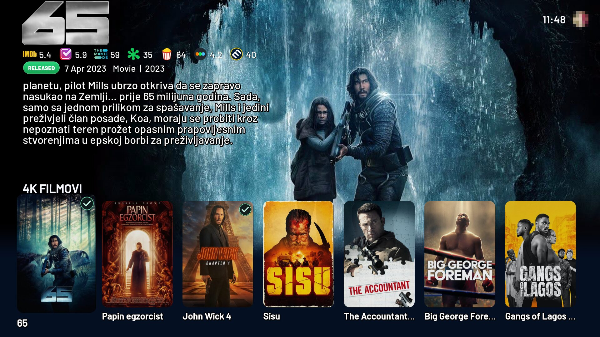

## MegaSport

Live scores of every sport: live, today and coming up.

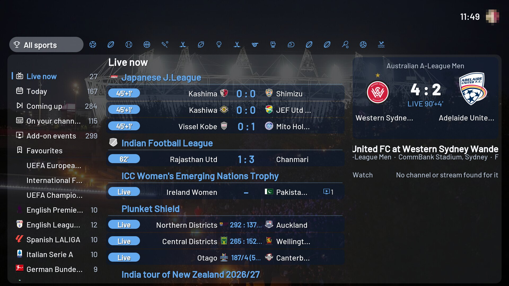

League tables.

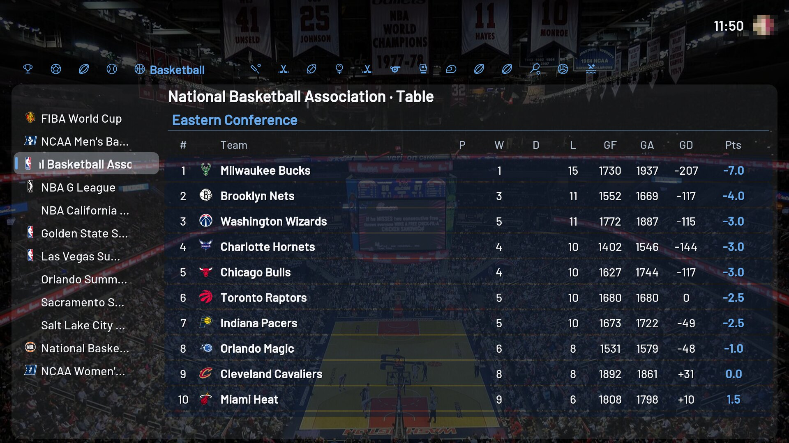

Your favourite teams: their next matches and results.

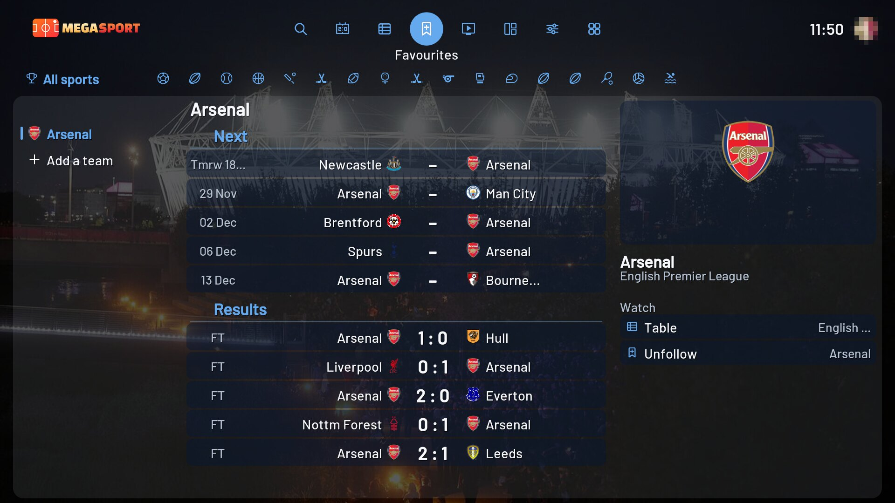

A match: the streams of your sport add-ons and the IPTV channel that shows it.

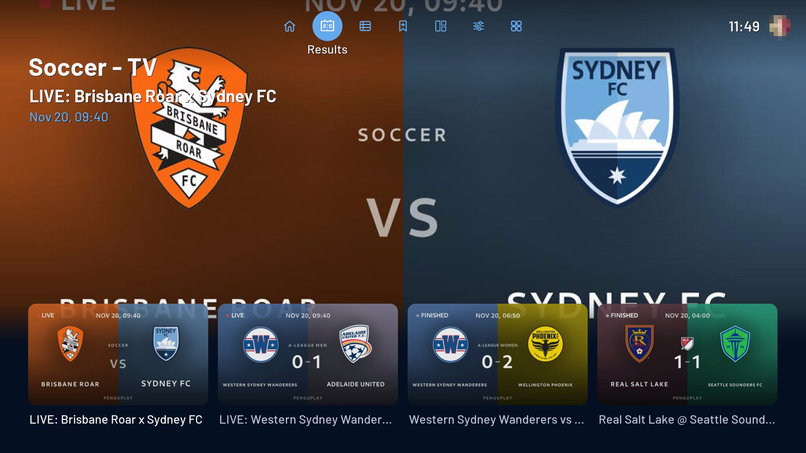

## YouTube

MegaNexus' own YouTube screen: categories, search and your channels.

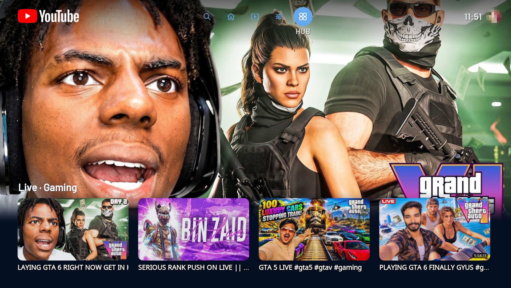

## Music

Recently played, For you, the artists you follow ...

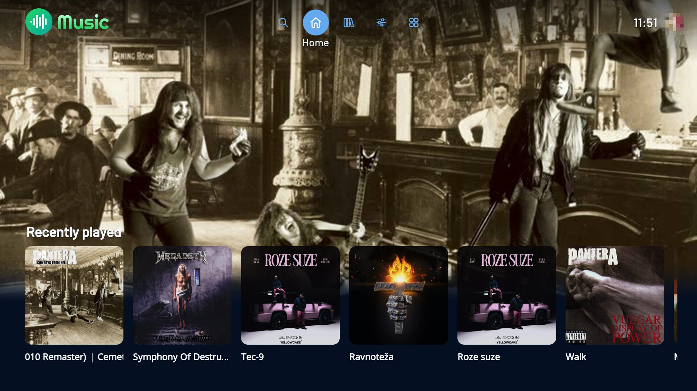

... and the song playing, on through all of MegaNexus.

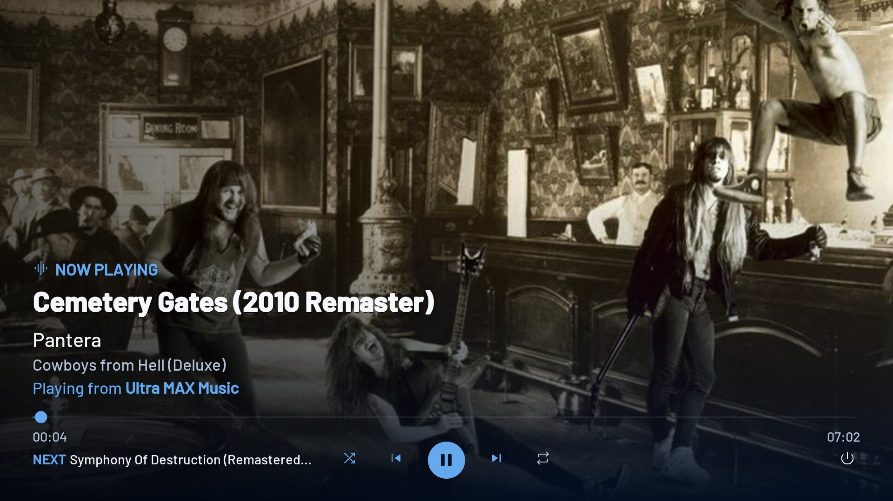

---

▶️ **[MegaNexus 9.0.0 in action (video, the earlier look)](https://github.com/MegaNexusMediaPlayer/MegaNexus/releases/download/v9.0.0/MegaNexus-9.0.0-preview.mp4)**
